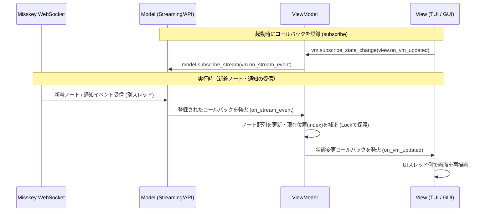

# MisT 再設計・実装計画 (`keikaku.md`)

## 1. 現状の課題と再設計の方針

### 現状の問題点
1. **`old_misskey_tui.py` の課題**
   - 1ファイルに通信・設定・画面描画（`asciimatics`）がすべて密結合しており、保守・拡張が困難。
2. **旧 `misskey_tui/` の課題**
   - MVVMモデルを目指したものの、`ViewModel` が `self.view` を保持して `self.view.textbox.value = ...` や `self.view.popup(...)`、`self.view.screen.width` などを直接操作してしまっていた（ViewとViewModelの密結合）。
   - `Model` 側にも `asciimatics` の `THEMES` や「現在何番目のノートを見ているか（`index`）」といったUI寄りの関心事が混ざっていた。

### 今回の設計方針（MVVMの鉄則）
依存の方向を **`View` ➔ `ViewModel` ➔ `Model` の一方向のみ** に統一し、逆方向の参照を一切持たせない。

- **`Model`（データ・通信・永続化）**
  - `ViewModel` も `View` も一切知らない。
  - Misskey APIとの通信、設定ファイル（`mistconfig.conf`）の読み書き、ドメインデータの管理のみを行う。
- **`ViewModel`（画面の状態管理・表示用ロジック・Modelの操作）**
  - `View`（`asciimatics` 等）を一切インポートしないし、`self.view` も持たない。
  - 画面が表示すべき「状態（プロパティ）」と、ユーザー操作に対応する「コマンド（メソッド）」、状態変化を知らせる「イベント／コールバック通知」だけを提供する。
  - ※ 画面幅（`screen.width`）に応じた区切り線の描画や、ポップアップWidgetの生成などはViewの仕事とし、ViewModelは「通知メッセージの内容」や「構造化された表示データ」を渡すに留める。
- **`View`（描画・入力受付・画面遷移）**
  - 唯一 `asciimatics`（将来GUIを作るならGUIライブラリ）に依存する層。
  - `ViewModel` のイベントを購読（subscribe）して画面を描画更新し、ボタン押下時に `ViewModel` のメソッドを呼ぶ。

### 動的更新（WebSocketストリーミング等）の伝搬ルール（Observerパターン）
依存の向きは `View` ➔ `ViewModel` ➔ `Model` だが、WebSocket等で `Model` 側に発生した動的イベントを画面に反映するため、**コールバック登録（Observerパターン）** で下から上へ通知を上げる。

- **ポイント1（疎結合の維持）**：`Model` は「登録された関数を呼ぶだけ」なので相手が `ViewModel` であることを知らず、`ViewModel` も相手が `View` であることを知らない。
- **ポイント2（スレッドセーフと再描画）**：WebSocketはバックグラウンドスレッド（または非同期ループ）で動くため、`ViewModel` の状態更新時はロック（`RLock`）で保護し、`View` 側（`asciimatics` やGUI）は自身の描画ループ（フレーム更新やUIスレッドキュー）に合わせて画面を書き換える。

---

## 2. アプリに必要な情報の整理（Model vs ViewModel）

元の [old_misskey_tui.py](file:///c:/Users/Owner/Documents/GitHub/MisT/old_misskey_tui.py) の全機能を洗い出し、「Modelが持つべき情報」と「ViewModelが持つべき情報」に分類する。

### A. `Model` が持つべき情報・責務（フロントエンド非依存のコア領域）
1. **コア設定・アカウント管理 (`CoreConfigModel` / `AccountRepository`)**
   - コア設定ファイル（例：`mistconfig.conf`）のロード・バリデーション・セーブ
   - 登録済みアカウント一覧（`name`, `instance`, `token`, `reacdeck`）のCRUD
   - デフォルトアカウントのインデックス
   - ※ `theme` などTUI/GUI固有の見た目設定はここには含めない（フロントエンド別設定として分離する）
2. **セッション・REST API通信 (`MisskeyClient` / `ApiService`)**
   - 現在接続中のインスタンスURL、認証トークン、ログイン中ユーザー情報（`i`）
   - インスタンスのメタ情報（`meta`）・アイコンデータの取得
   - MiAuth認証フロー（認証URL生成、トークン取得確認）
   - タイムライン取得（`HTL`, `LTL`, `STL`, `GTL` / `limit`, `since_id`, `until_id`）
   - ノート操作（単体ノート取得 `notes_show`、ノート投稿 `notes_create`、リノート、リアクション付与 `notes_reactions_create`）
   - 通知一覧取得（`i_notifications`）
3. **WebSocketストリーミング通信 (`StreamingService` / `brominecore` ラッパー)**
   - 自作ライブラリ `brominecore`（`brcore.Bromine`）を使用して `wss://{instance}/streaming` へ接続・自動再接続管理を行う
   - バックグラウンドスレッド上の専用 `asyncio` イベントループで `brm.main()` を実行する
   - タイムラインチャンネル（`MisskeyChannelNames.HOME_TIMELINE`, `LOCAL_TIMELINE`, `HYBRID_TIMELINE`, `GLOBAL_TIMELINE`）の `ws_connect` / `ws_disconnect` による動的切り替え（別スレッドからは `loop.call_soon_threadsafe` 経由で安全に呼ぶ）
   - `MAIN` チャンネル（リアルタイム通知・メンション等）の購読や、`ws_subnote` / `ws_unsubnote`（ノートのリアクション更新等のリアルタイムキャプチャ）の活用
   - インスタンスやアカウント（トークン）切り替え時は、現在の `brm.main()` タスクをキャンセルして新しい `Bromine(instance, token)` で再起動する
   - 受信した新着ノートや通知（`body`）をコールバック（イベント）として発火する仕組み
4. **インメモリ／ローカルDBストレージ (`DatabaseService` / `sqlite3`)**
   - `sqlite3`（デフォルトは `:memory:`、設定次第でファイルDBへ切替可能）を用いて、取得したノート・通知・カスタム絵文字（リアクションDB）を一元管理する
   - **一元管理のメリット**：
     - 通常のノート、RN元、返信先、通知内のノートなどを `note_id`（＋`instance`）をキーに一元化でき、`ws_subnote` 等でリアクション数などが更新された際に一箇所の更新で全画面のデータが最新化される
     - 将来のマルチユーザー／マルチインスタンス同時接続時も `account_id` や `instance` カラムで綺麗に分離・検索できる
     - 数万件あるカスタム絵文字のインクリメンタル検索もSQLクエリで高速に処理でき、ファイルDBモードにすればRAM消費も最小限に抑えられる
   - **スレッドセーフ設計**：WebSocketスレッド（書き込み）とUIスレッド（読み取り）から安全に触れるよう、`RLock`（または共有インメモリURI `file::memory:?cache=shared`）で保護する
   - **ハイブリッドスキーマ**：検索・ソート・リレーションに必要な項目（`note_id`, `instance`, `created_at`, `tl_type` 等）はカラム化し、柔軟性が必要なペイロードはJSONとして保持する

### B. フロントエンド固有設定（TUI設定 / GUI設定）の扱い
TUIのテーマ（`asciimatics` の `THEMES`）や表示言語（`lang`）、GUIのウィンドウサイズなどはフロントエンドごとに異なるため、**コア設定ファイルとは別ファイルで管理する**（例：`mist_tui.conf` / `mist_gui.conf`）。

- **どうやって `Model` ➔ `ViewModel` ➔ `View` の順に通すか（パススルー方式）**：
  1. **`Model`（汎用Configストレージ）**：
     - `load_frontend_config(name: str, default: dict)` / `save_frontend_config(name: str, data: dict)` のように、「フロントエンド名（`"tui"` など）を指定してJSONを読み書きする土管」だけを提供する。
     - `Model` 自身は中身に `theme` や `lang` があることを一切知らない。
  2. **`ViewModel`（中継＆変更イベント通知）**：
     - `ViewModel` もフロント設定の具体的な中身には関知せず、`get_frontend_config()` で `Model` から設定を取得して `View` に渡し、`update_frontend_config()` が呼ばれたら `Model` に保存させた上で「フロント設定が更新された」というイベントを発火する。
  3. **`View`（スキーマ定義・解釈・適用）**：
     - `View` 側で必要な設定項目（TUIなら `theme`, `lang`）のデフォルト値やバリデーションを持ち、`ViewModel` 経由で取得・更新する。

### C. `ViewModel` が持つべき情報・責務（画面／機能ごと）
1. **タイムライン画面 (`TimelineViewModel`)**
   - 現在のタイムライン種別（`HTL` / `LTL` / `STL` / `GTL`）
   - 取得済みノート配列と、**現在選択中のノート位置 (`current_index`)**
   - 現在表示中のノート情報（表示用に整形された投稿者名、CW、本文、にゃー化処理、ファイル数、RN/返信/リアクション数など）
   - ナビゲーション状態（`can_move_prev`, `can_move_next`, `is_logged_in`）
   - アクション（TL取得・更新、前後移動、現在ノートへのRN・リアクション付与）
2. **ノート作成画面 (`CreateNoteViewModel`)**
   - 作成中のノート状態（`text`, `cw`, `visibility`, `reply_id`, `renote_id`、返信先・引用先ノートのプレビュー情報）
   - アクション（本文更新、定型文/顔文字挿入、絵文字挿入、オプション変更、投稿実行、リセット）
3. **リアクション・絵文字選択 (`ReactionSelectViewModel`)**
   - 検索クエリ文字列、フィルタリングされた絵文字候補リスト
   - 選択時のモード（①対象ノートにリアクションする、②リアクションデッキに追加する、③作成中ノートに絵文字を追記する）
4. **通知画面 (`NotificationViewModel`)**
   - 取得済み通知リスト、フィルタフラグ（Follow, Mention, Reply, Quote, Renote, Reaction）
   - フィルタ適用後の表示用通知データ、選択した通知の対象ノート情報
5. **設定画面 (`ConfigViewModel`)**
   - アカウント一覧の選択・追加（MiAuth / 手入力）・削除・デフォルト設定
   - 接続先インスタンス変更、リアクションデッキの追加・削除
   - フロントエンド設定（`dict` / 汎用設定）の取得・更新の中継

---

## 3. 実装手順（ロードマップ）

以下の4フェーズで、下の層（Model）から順番に実装・動作確認を進める。

### Phase 1: `Model` 層の設計・実装（`src/mist/model/`）
- [ ] **Step 1-1: データ型（Dataclass / Enum）の定義**
  - アカウント設定（`AccountConfig`）、コア設定（`CoreConfig`）、ノート（`Note`）、通知（`Notification`）、タイムライン種別（`TimelineType`）、公開範囲（`Visibility`）などの型を定義する（UIライブラリ非依存）。
- [ ] **Step 1-2: 設定管理モデル (`ConfigModel`) の実装**
  - コア設定（`mistconfig.conf`）の読み書き、アカウント追加・削除・更新の実装。
  - フロントエンド別設定ファイル（`mist_<frontend>.conf`）を読み書きする汎用メソッドの実装。
- [ ] **Step 1-3: SQLiteデータストレージ (`DatabaseService`) の実装**
  - `sqlite3`（デフォルト `:memory:`、ファイルパス指定でディスクDBにも切替可能）によるノート・タイムライン紐付け・通知・絵文字DBの一元管理テーブルとCRUDを実装する。
- [ ] **Step 1-4: Misskey REST APIクライアント (`ApiClient`) の実装**
  - `misskey.py` と `requests` をラップし、インスタンス接続、MiAuth、TL取得、ノート作成、RN、リアクション、通知取得、絵文字DB取得を実装する。
  - エラー時はUIを直接触らず、明確な例外またはResult型（成功/失敗）を返すようにする。
- [ ] **Step 1-5: WebSocketストリーミング (`StreamingService`) の実装**
  - `uv add brominecore`（またはgitリポジトリ指定）で `brcore` を導入する。
  - バックグラウンドスレッド＋専用 `asyncio` ループで `Bromine.main()` を動かし、`ws_connect` / `ws_disconnect` / `ws_subnote` で受信した非同期イベントを同期コールバックに変換して上位（`ViewModel`）へ通知するラッパーを実装する。
- [ ] **Step 1-6: `Model` 統合クラスの作成と単体動作確認**
  - UIなしでPythonスクリプト／テストから「設定読込 ➔ API接続 ➔ TL取得・DB保存＆ストリーミング受信」が動くことを確認する。

### Phase 2: `ViewModel` 層の設計・実装（`src/mist/viewmodel/`）
- [ ] **Step 2-1: イベント通知・状態バインディング基盤の作成**
  - ViewModelからViewへ「状態が更新された」「メッセージ（エラー/成功）を表示してほしい」「画面遷移してほしい」を通知するシンプルなObserver（コールバック）仕組みを作る。
- [ ] **Step 2-2: コア画面のViewModel実装**
  - `TimelineViewModel`（ノート閲覧・更新・前後移動・RN・リアクション）
  - `ConfigViewModel`（アカウント管理・インスタンス接続・各種設定）
- [ ] **Step 2-3: サブ画面のViewModel実装**
  - `CreateNoteViewModel`（ノート投稿・CW/公開範囲/返信/引用設定）
  - `ReactionSelectViewModel`（絵文字DB取得・インクリメンタル検索・選択処理）
  - `NotificationViewModel`（通知取得・種別フィルタ・通知からのアクション）

### Phase 3: `View` 層の設計・実装（`src/mist/view/`）
- [ ] **Step 3-1: `asciimatics` 共通コンポーネント・画面遷移管理の作成**
  - 各Viewが対応するViewModelを受け取り、コールバックを登録して描画更新するベース構成を作る。
- [ ] **Step 3-2: 各画面（Scene / Frame）の実装**
  - `NoteView`（メイン画面）
  - `ConfigView`（設定画面）
  - `CreateNoteView` & 設定ダイアログ/画面
  - `SelectReactionView`（絵文字検索・選択画面）
  - `NotificationView`（通知画面）

### Phase 4: 仕上げ・周辺機能の統合
- [ ] 多言語対応（`locale/`）の整理と統合
- [ ] 自動更新処理（旧 `daemons/anupd.py` 相当）の安全な組み込み
- [ ] 不要になった旧ファイル（`old_misskey_tui.py`, `misskey_tui/`, `daemons/`）の整理
